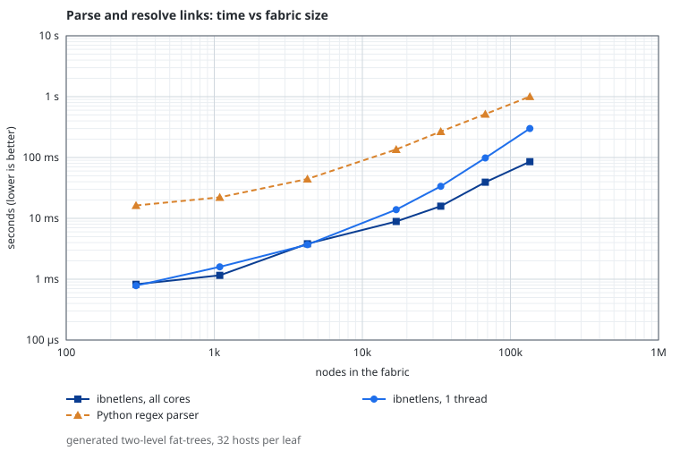
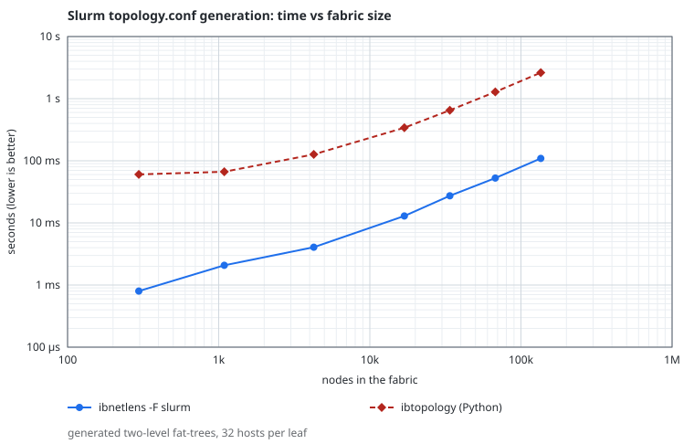
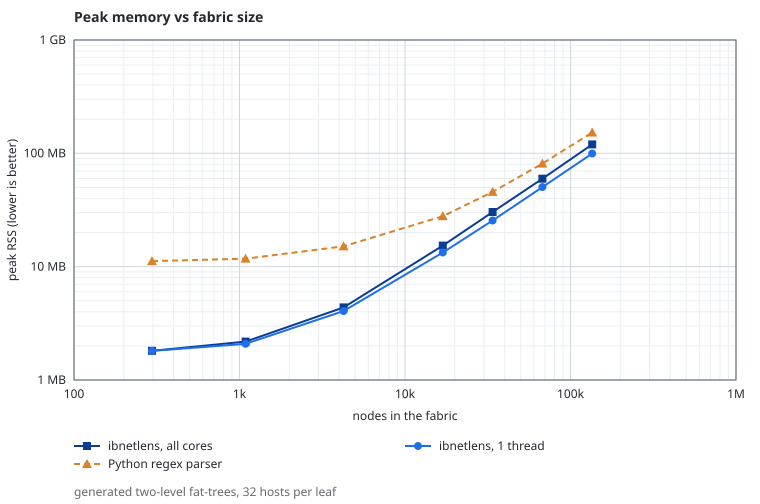
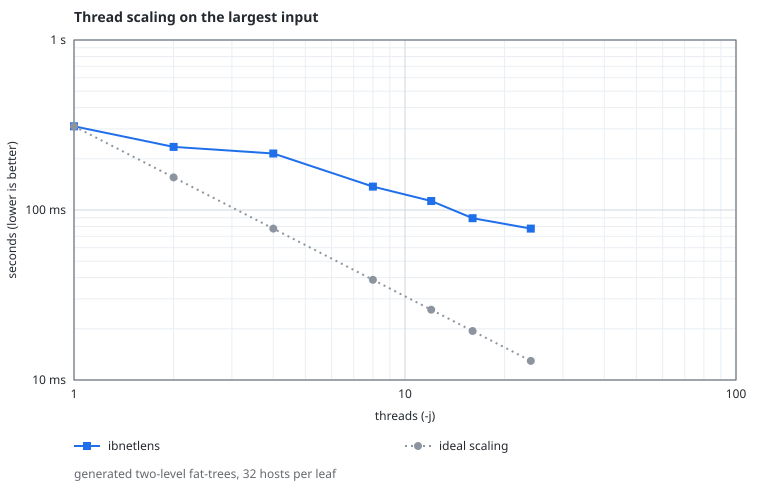

# ibnetlens

Parser, validator and converter for InfiniBand topology files, in C with no dependencies beyond libc.
It reads `ibnetdiscover` output (and the free-form net files used by `ibsim`) and turns it into
JSON, CSV, Graphviz, a Slurm `topology.conf`, or checks it for inconsistencies.

```
ibnetdiscover > fabric.topo
ibnetlens check fabric.topo                    # find inconsistencies, exit 1 if any
ibnetlens -F slurm fabric.topo > topology.conf # Slurm tree topology
ibnetlens -F dot fabric.topo | dot -Tsvg > fabric.svg
ibnetlens diff yesterday.topo today.topo       # what changed on the fabric
ibnetdiscover | ibnetlens -F csv -             # read from a pipe
```

## Background

ibnetlens started as `topo_parser`, a small parser that turned a topology file into one fixed report and took 23 s
on a 54 MB dump. It was rewritten from scratch for three reasons:

- Two of the open-source tools for this job that were found while preparing it, `ibtopology` (writes a Slurm
  topology file, with an optional JSON dump) and `infiniband_topology` (converts a dump to JSON for a d3.js web
  viewer), are Python 2 scripts: they use the `print` statement and do not parse under Python 3, and Python 2 is not
  packaged in Ubuntu 24.04, Debian 12, Fedora 44 or Rocky Linux 9 (checked in October 2026). A single native binary has
  no interpreter to install on a login node.
- Parsing, validating, comparing and converting a fabric is one job. Doing all four in one tool that
  finishes in milliseconds makes it practical to run from cron or CI.
- On large fabrics a compiled parser is several times faster and lighter than the Python equivalents (data
  below). On a few hundred nodes every tool is instant and this does not matter.

It is written in C11 with no dependencies beyond libc, which is also what keeps the install to a single small file.

## Commands

| command | purpose |
|---|---|
| `parse` (default) | convert to another format with `-F` |
| `check` | validate the fabric |
| `diff OLD NEW` | compare two snapshots |
| `info` | node, link and speed counts |

Options: `-F format`, `-o file`, `-j N` threads (default: automatic), `--strict`, `-q`, `--json` (check and diff),
`--exclude TEXT` (slurm), `--progress` / `--no-progress`, `--stats`.
Exit status: `0` ok, `1` findings or differences, `2` usage or input error.

### Progress and scripts

On a terminal a progress bar appears for inputs that take more than a fraction of a second and is erased when
parsing ends. It is never shown when stderr is not a terminal, so pipes, cron and CI logs stay clean; `-q` hides
it as well. `--no-progress` turns it off explicitly (use it in scripts that may run on a terminal),
`--progress` forces it on, printing one plain line per 10% when stderr is not a terminal.
`--stats` prints phase times, peak memory, thread count and node/port counts to stderr as one `key=value` line.

## Input

- `ibnetdiscover` topology files, including routers (`Rt`), enhanced/base switch port 0, CRLF line endings.
- The extended layout written by NVIDIA's `ibdiagnet` (`ibdiagnet2.ibnetdiscover`), which puts a port label in
  parentheses after every port number (`[1](1)(2c9...)`); labels are accepted and dropped.
- The `ibsim` net-file dialect: free-form node IDs (`"Switch1"`), `Hca` nodes, omitted remote port,
  `w=` port options, `switchguid=`/`hcaguids=`/`caguid=` GUID bases. Node GUIDs come out the same as in ibsim 0.10 and 0.12.1
  (`tests/xcheck-ibnetdiscover.sh`: default counters and absolute `0x` GUID bases). Not supported: `include`,
  `@alias`, the relative form `switchguid+N`, and GUID bases written without the `0x` prefix (ibsim reads those as
  decimal). ibsim 0.12.1 itself rejects `w=` on a link line that carries no `lid` data, although its documentation
  describes the option; ibnetlens accepts it. Large net files are parsed on several threads like dumps.
- Malformed lines are reported with their line number and skipped. `--strict` stops at the first one.

## Formats

`json` (default), `csv` (links), `csv-nodes`, `dot`, `slurm`, `ibnd` (ibnetdiscover layout, which ibsim also reads),
`legacy` (the report of the old topo_parser, reproduced byte for byte on the test fabrics that tool could read).

Kept from the dump: GUIDs, LIDs, LMC, link speed and width, node descriptions, vendor and device IDs, switch port 0
information. Not kept: the port labels of ibdiagnet files and unrecognised trailing tokens on a line.

### Slurm

A switch with at least as many hosts as links to other switches is a leaf and becomes a `Nodes=` line. Other
switches list the switches one level below them in `Switches=`. A spine that also serves hosts gets a synthetic
leaf (`<name>h`) for them, because Slurm does not allow `Nodes=` and `Switches=` on one switch (slurmctld 23.11
stops with `switch ... has both child switches and nodes`). Host names are the
first word of the adapter description; `--exclude TEXT` drops adapters that are not compute nodes. Switch names are
`sw<level>n<index>`, and a comment above each line gives the GUID and description. Several top-level switches
(a two-spine fabric) are emitted as they are.

## Checks

| code | severity | meaning |
|---|---|---|
| `duplicate-guid` | error | two nodes share a GUID |
| `duplicate-lid` | error | two nodes or adapter ports share a LID |
| `duplicate-port` | error | a port is listed twice on one node |
| `missing-reverse-link` | error | the remote port is not listed |
| `asymmetric-link` | error | the remote port reports a different peer |
| `kind-mismatch` | error | remote ID says switch/host/router, node is something else |
| `unknown-peer` | warning | remote node is not in the file (partial discovery) |
| `speed-mismatch` | warning | the two ends report different speed or width |
| `degraded-link` | warning | link is slower than most links of its class (switch-switch, switch-adapter) |

`--json` prints one JSON object per finding.

## Validation against real tools

These checks run in `make check` / `tests/selftest.py` and need the tools installed (otherwise they are skipped).
Fabrics are simulated with `ibsim`, and the tools discover them through its `umad2sim` library.

- **NVIDIA `ibdiagnet` 2.26 and `ibtopodiff` (ibutils2 from the public DOCA repository).**
  ibdiagnet discovers the simulated fabric; ibnetlens parses the topology file ibdiagnet writes in strict mode, the node
  counts equal ibdiagnet's totals, and the link set equals the simulated fabric. `ibtopodiff -e` and `ibnetlens diff`
  find the same removed hosts, both call identical files equal, and `ibtopodiff` reads ibnetlens's `ibnd` output and
  finds it identical to the original. `tests/fetch-nvidia.sh` downloads and unpacks these packages without root.
  This comparison exposed a real format difference (ibdiagnet's port labels), which ibnetlens now handles.
- **`ibnetdiscover`, `iblinkinfo`, `ibnetdiscover --diff`** from infiniband-diags, both NVIDIA's build 2604.0.7 and
  Ubuntu's 50.0: the real output parses in strict mode, node and port counts equal those of `ibnetdiscover -S/-H`
  and `iblinkinfo`, the discovered link set equals the simulated fabric, and `--diff` and `ibnetlens diff` both report
  the removed hosts.
- **`slurmctld` 23.11.4** loads the generated `topology.conf` with the tree plugin, building all switches and levels
  without errors, for two-level fat-trees, a generated three-level fat-tree, a real two-spine dump, a spine that
  serves hosts, and an ibsim net file. Torus, dragonfly and other fabrics, and other Slurm versions, were not tested.
- **Not covered:** ibdiagnet's own link and routing checks cannot be compared on a simulator (it leaves every link in
  the INI state and ignores vendor MADs), so `check` was compared with ibdiagnet only through the speeds it records.
  NVIDIA UFM is a licensed platform; the repository only offers a `doca-ufm` meta-package of dependencies, so no
  comparison with UFM was possible.

### Large fabrics against the real `ibnetdiscover`

Two-level fat-trees simulated with ibsim and discovered by the real `ibnetdiscover` (`XCHECK_LARGE=1`). In every row the
discovered link set equals the simulated fabric. Times are for the discovery through the simulator, with Ubuntu's
infiniband-diags 50.0 and NVIDIA's 2604.0.7 (`-` where a build was not run on that size).

| fabric (leaves x spines x hosts) | nodes | ports | 50.0 | NVIDIA 2604 |
|---|---|---|---|---|
| 128 x 16 x 32 | 4,240 | 12,288 | 0.14 s | - |
| 250 x 32 x 64 | 16,282 | 48,000 | 1.4 s | 4 s |
| 250 x 100 x 128 | 32,350 | 114,000 | 11.3 s | 13 s |
| 254 x 64 x 191 | 48,832 | 129,540 | 23.2 s | - |
| 254 x 16 x 239 | 60,976 | 129,540 | 39.9 s | 39 s |

NVIDIA's `ibdiagnet` also discovers the 250 x 32 x 64 fabric completely (282 switches, 16,000 adapters), and the topology
file it writes matches the simulated fabric link for link.

ibnetlens parses the 16 MB dump of the 48,832-node fabric in 33 ms on one thread and 17 ms with all cores. The two
tools solve different problems (live discovery against offline parsing), so the times are context, not a race.
The simulator limits the size: the net file format allows 1 to 255 ports per node, so a spine of 256 leaves comes
back from ibsim with no ports; the table stays below that.

### Architectures

The package builds and the whole self-test run in clean Ubuntu 24.04 and Fedora 44 containers on both architectures:

| container | result | skipped checks |
|---|---|---|
| Ubuntu 24.04, x86-64 | all checks pass | none |
| Fedora 44, x86-64 | all checks pass | 1 (Fedora ships no Slurm `auth/none` plugin) |
| Ubuntu 24.04, aarch64 (qemu) | all checks pass | 1 (NVIDIA tools are x86-64 only) |
| Fedora 44, aarch64 (qemu) | all checks pass | 2 (the two above) |

On aarch64 the SIMD hex parser is not compiled in and the scalar path is used, which `make test-scalar` also covers on x86.
The aarch64 runs are emulated, so they say nothing about speed on real ARM hardware.

## Comparison

Measured on an Intel Core i9-12900K (24 threads), Ubuntu 24.04, Python 3.12, on generated two-level fat-trees with
32 hosts per leaf. Raw data and the full report are in `bench/results/i9-12900K-ubuntu24/`; the commands to
repeat the measurement are at the end of this section and in `docs/TESTING.md`.

### What the tools do

| | ibnetlens | ibtopology | infiniband_topology | InfiniBand-Graphviz | LLNL ibtopo |
|---|---|---|---|---|---|
| language | C | Python 2 | Python 2 + JS | Python 3 + pygraphviz | Perl |
| Slurm topology.conf | yes | yes | no | no | no |
| JSON / CSV | yes | JSON dump | JSON | no | no |
| Graphviz / Gephi | dot | no | d3 web view | dot, gexf | no |
| consistency checks | yes | no | no | no | switch level analysis (fat-tree) |
| snapshot diff | yes | no | no | no | no |
| `ibsim` net files | yes | not documented | not documented | not documented | not documented |
| runs without extra packages | yes | needs python-hostlist, xmltodict | needs jsonpickle | needs pygraphviz | needs Perl |

For the other tools the table is based on their README and source code (searched for Slurm, JSON, CSV, Graphviz, diff,
ibsim and consistency checks); "no" means the feature is absent from both. Only `ibtopology` and a plain Python parser
were run, for the timings and the audit below.
NVIDIA's ibdiagnet and ibtopodiff were run for the cross-checks above, not for timings: ibdiagnet discovers live
fabrics and ibtopodiff compares two files, so they do not answer the same question as the Python converters.

### Speed and memory







At 135,200 nodes (55 MB input):

| | time | peak memory |
|---|---|---|
| ibnetlens parse, 1 thread | 0.30 s | 100 MB |
| ibnetlens parse, all cores | 0.085 s | 120 MB |
| plain Python regex parser (`bench/ref_parse.py`) | 1.00 s | 153 MB |
| `ibnetlens -F slurm` | 0.11 s | |
| `ibtopology` (ported to Python 3) | 2.63 s | 274 MB |

On a 54 MB, 97,000-node ibnetdiscover dump (not included in the repository) the original topo_parser needed 23 s:
ibnetlens needs 0.09 s on one thread and 0.03 s with all cores, the Python baseline 1.0 s. Four copies of that dump
(216 MB) parse in 0.12 s with all cores and 0.35 s on one thread; the threaded run peaks at 500 MB because the
per-thread results are merged.

A 12.8 MB ibsim net file with 135,200 nodes parses in 0.26 s on one thread and 0.10 s with threads.

On the 152-node real dump from the `infiniband_topology` repository everything is instant:
ibnetlens under 1 ms (0.6 ms), the Python baseline 14 ms (mostly interpreter start), `ibtopology` 44 ms.



Threads help less than linearly: the input is split at node-block boundaries and parsed in parallel, but GUID
registration is serial and link resolution is bound by memory latency; on the test machine the gain also diminishes
beyond about 8 threads, and that CPU mixes performance and efficiency cores. Whether other CPUs scale better was not
measured.

### Correctness on real data

`bench/audit.py` counts how many hosts of the input are listed in the generated `topology.conf` and how many sit under a
leaf switch that has no parent switch. The output of `ibtopology` on one file changes from run to run (it depends on
Python's string hash seed), so it is run 50 times with different seeds:

| input | hosts | tool | listed | detached |
|---|---|---|---|---|
| real dump, 8 SX6036 switches | 144 | ibnetlens | 144 | 0 (every run) |
| | | ibtopology | 144 | 26 in 26 of 50 runs, 2 in the other 24 |
| generated k=4 n=3 fat-tree | 128 | ibnetlens | 128 | 0 |
| | | ibtopology | 0 (stops with an error in all 50 runs) | |
| generated fat-tree, 128 leaves | 4096 | ibnetlens | 4096 | 0 |
| | | ibtopology | 4096 | 0 (every run) |

On the real dump the two hosts `tank[1-2]` are outside the tree in every `ibtopology` run (their switch is a spine that
also serves hosts), and in about half of the runs one more leaf switch with 24 hosts is missing under the root.
ibnetlens gives the same output on every run (20 runs compared) and puts the two hosts under a synthetic leaf. On the
k=4 n=3 file `ibtopology` stops with `AttributeError`: its pattern for the switch header requires a `lid` field,
and that file, which comes from a topology generator rather than from ibnetdiscover, has none in the header.
These are results for the ported script on these inputs, not a general verdict on the tool.

### Reproduce

```
python3 tests/selftest.py --bench full --tag my-machine   # tests + benchmark + HTML report
bench/fetch-analogs.sh                                     # optional: download and port ibtopology first
python3 bench/audit.py FILE.topo ...                       # reachability audit
```

## Install

Fedora (x86_64, aarch64) from COPR; the repository is signed by COPR:

```
sudo dnf copr enable atumanyan/ibnetlens
sudo dnf install ibnetlens
```

The COPR install was tested on Fedora 44 x86_64. Debian and Ubuntu packages are attached to the GitHub releases.

## Packages

```
make deb      # build/pkg/ibnetlens_<version>_<arch>.deb      (Debian, Ubuntu)
make rpm      # build/rpm/RPMS/<arch>/ibnetlens-<version>.rpm  (built and tested on Fedora 44)
```

Both packages depend only on libc. `packaging/docker-test.sh` builds each in a clean container, installs and removes
it, and runs the whole self-test against the installed binary; Ubuntu 24.04 and Fedora 44 pass (details in
`docs/PACKAGING.md`).

## Verifying downloads

Release files (`.deb`, `.rpm`, source tarball) are published with detached GPG signatures (`.asc`) and a signed
`SHA256SUMS`; the RPMs also carry an embedded RPM signature. The signing key is in `packaging/ibnetlens-release.asc`:

```
gpg --import packaging/ibnetlens-release.asc
gpg --fingerprint "ibnetlens release signing key"   # 2504 46BC 3970 DF96 FB44  862E 79D9 8732 D385 788E
gpg --verify SHA256SUMS.asc SHA256SUMS && sha256sum -c SHA256SUMS --ignore-missing
sudo rpm --import packaging/ibnetlens-release.asc && rpm -K ibnetlens-*.rpm       # RPM
```

## Support

Bug reports are welcome; please attach the smallest topology file that shows the problem, with node names and GUIDs
masked if needed. There is no support guarantee.

## Documentation

- `docs/DEVELOPER.md` - architecture, data model, grammar, threading, how to extend
- `docs/TESTING.md` - running the tests on any machine, reports, comparing machines
- `docs/PACKAGING.md` - deb and rpm builds, container tests, release checklist
- `man ibnetlens`

## Build

```
make            # builds ./ibnetlens
make test       # golden, round-trip and unit tests
make asan       # same under AddressSanitizer and UBSan
make tsan       # same under ThreadSanitizer
make test-scalar  # tests with the SIMD code left out (as on non-x86 CPUs)
make fuzz       # libFuzzer, needs clang
make bench      # quick comparison with a plain Python parser
make check      # tests/selftest.py: every suite available here, with an HTML report
make install PREFIX=/usr/local
make static     # static binary
make deb        # Debian/Ubuntu package (build/pkg/)
make rpm        # RPM package, tested on Fedora 44 (build/rpm/)
```

## Implementation notes

- One pass over the mmap'd input, no per-line allocation, bounds-checked integer parsing.
- Input is split at `vendid=` block boundaries (at node headers for ibsim net files) and parsed by several threads;
  the output and the diagnostics are identical to a single-threaded run (tested). GUIDs of ibsim-style nodes depend
  on file order, so they are assigned after the chunks are merged.
- GUIDs are parsed with SSSE3 when the CPU has it (runtime detection, scalar fallback, equivalence tested on
  300,000 random inputs). Most of the speed comes from the single pass and threads; the SIMD parser together with
  compile-time literal matching accounts for roughly 10% of the single-thread time.
- Link resolution uses an open-addressing GUID table and software prefetch.
- The parser is fuzzed with libFuzzer under ASan/UBSan.

## License

MIT, see `LICENSE`.
