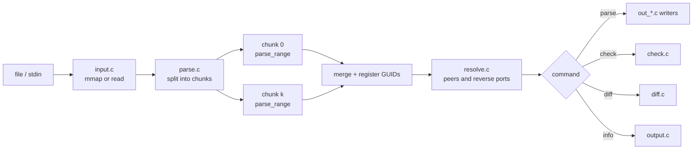

# ibnetlens developer guide

This document describes how ibnetlens is put together, why it is built that way, and how to extend it.
User-facing behaviour is in `README.md` and `man/ibnetlens.1`; testing is in `docs/TESTING.md`;
packaging in `docs/PACKAGING.md`.

## Contents

1. [Goals and constraints](#goals-and-constraints)
2. [Source layout](#source-layout)
3. [Data model](#data-model)
4. [Input grammar](#input-grammar)
5. [Parsing pipeline](#parsing-pipeline)
6. [Threading](#threading)
7. [Link resolution](#link-resolution)
8. [SIMD and other low-level choices](#simd-and-other-low-level-choices)
9. [Output formats](#output-formats)
10. [Checks and diff](#checks-and-diff)
11. [Command line, progress and exit codes](#command-line-progress-and-exit-codes)
12. [How to extend](#how-to-extend)
13. [Limits](#limits)
14. [Conventions](#conventions)

## Goals and constraints

- Read very large `ibnetdiscover` dumps (hundreds of megabytes, millions of lines) in well under a second.
- Never trust the input: no buffer overruns on malformed files, no undefined behaviour on integer overflow.
- Keep the fields of the dump that the output formats need, so that every format can be produced from the same
  in-memory fabric (port labels of ibdiagnet files and unrecognised trailing tokens are dropped).
- Dependencies: libc and POSIX only (`mmap`, `pthread`). Nothing is vendored. Python is used only by the
  test and benchmark tooling, never by the program.
- C11, warning-clean under gcc and clang with `-Wall -Wextra -Wpedantic -Wshadow -Wstrict-prototypes`
  (and `-Wconversion`).

## Source layout

| file | responsibility |
|---|---|
| `src/ibnetlens.h` | all shared types (`ib_fabric`, `ib_node`, `ib_port`) and the cross-module function declarations |
| `src/util.[ch]` | `ibt_die`, growable arrays (`ibt_grow`), thread helpers (`ibt_parallel_for`, `ibt_pick_threads`) |
| `src/guidmap.[ch]` | open-addressing table, 64-bit GUID to node index |
| `src/model.c` | fabric lifecycle, string pool, node/port arrays, name table for ibsim-style IDs, speed tables |
| `src/hex.[ch]` | hex digit run parser: scalar and SSSE3 versions, runtime selection |
| `src/input.c` | `mmap` of regular files, `read` fallback for pipes and stdin |
| `src/parse.c` | line parser, chunking, progress thread, merge of chunk results |
| `src/resolve.c` | peer lookup: node by GUID or name, reverse port; optionally threaded |
| `src/check.c` | consistency checks |
| `src/diff.c` | snapshot comparison |
| `src/output.c` | format names, dispatch, `info` summary |
| `src/out_text.c` | `legacy` and `ibnd` writers |
| `src/out_json.c` | `json`, `csv`, `csv-nodes`, `dot` writers |
| `src/out_slurm.c`, `src/hostlist.c` | Slurm topology.conf generation and hostlist compression |
| `src/main.c` | argument parsing, commands, stats, exit codes |
| `tests/` | golden fixtures, shell suites, unit tests, fuzz harness, fixture generator |
| `bench/` | benchmark driver, report generator, third-party baselines |
| `packaging/`, `debian/` | RPM spec, Debian packaging, container test drivers |



## Data model

`ib_fabric` (in `ibnetlens.h`) owns flat arrays and a string pool. There are no per-node allocations and no
pointers between records: everything refers to everything else by `uint32_t` index, which keeps records small,
makes merging chunks a `memcpy` plus index rebasing, and avoids pointer chasing in the hot loops.

- `nodes[]` - `ib_node`: GUID, sysimg GUID, switch port-0 GUID, kind (`IB_CA`, `IB_SWITCH`, `IB_ROUTER`),
  vendor/device id, LID/LMC (switches and routers; adapter LIDs are per port), declared port count, and
  `first_port`/`nports`, the node's range in `ports[]`.
- `ports[]` - `ib_port`: only connected ports appear, in file order, contiguous per node. Each holds the local
  port number and GUID, the remote node GUID/port/port GUID, LIDs, speed and width, and the resolved
  `peer_node` and `peer_idx` (index of the reverse port), both `IBT_NONE` while unresolved or when the
  remote end is missing.
- String pool - one `char` array; offset 0 is the empty string. Node descriptions and ibsim-style node IDs
  live here. Only descriptions of nodes are stored; the peer descriptions that appear on link lines are
  derived from the peer node when needed (the `ibnd` writer does this), which saves memory.
- `map` - `ibt_guidmap` from node GUID to node index; `names` - table of node indices keyed by ibsim ID.
- `dups[]` - pairs of node indices that share a GUID, reported by `check`.

`IBT_NONE` (`UINT32_MAX`) is the "no index" value everywhere; node and port counts are limited to
`IBT_NONE - 2`.

Speeds are the enum `ib_speed` (`SDR` ... `XDR`); `ib_rate_mbps` gives an effective data rate used by the
degraded-link check. `FDR10` is distinct from `FDR` and `QDR`.

## Input grammar

The parser is line oriented and tolerant. Lines are trimmed of trailing blanks and `\r`. A line starting with
`#` or blank is ignored.

```
vendid=0x2c9                      key lines: vendid, devid, sysimgguid,
devid=0xd2f0                      switchguid=X(Y), caguid=, rtguid=, hcaguids=
sysimgguid=0x...
switchguid=0x...(...)
Switch  N "S-<guid>"  # "desc" [enhanced|base] port P lid L lmc M      node header (Switch, Ca, Hca, Rt)
[p]  "H-<guid>"[q](peerportguid)  # "desc" lid L 4xHDR               link line on a switch or router
[p](portguid)  "S-<guid>"[q]  # lid L lmc M "desc" lid L 4xEDR        link line on an adapter
```

Details that matter when changing the parser:

- A `vendid=` line starts a new node block. This is also what makes parallel parsing possible (see below).
- Node IDs are `<S|H|R>-<hex>`. Any other quoted string is an **ibsim-style name**: the node then gets a
  synthetic GUID from per-kind counters (switches 0x200000, adapters 0x100000, routers 0x300000, advanced
  the way ibsim does it), and its ports refer to peers by name; `resolve.c` turns names into nodes.
- `lid` before the quoted description on a link line is the local LID, after it the remote LID.
- Parenthesised groups after a port number (`read_port_groups`): classic files carry a port GUID where there is one,
  ibdiagnet's extended files put a label in front of every port. Whether an end of the link has a GUID follows from
  its node type (adapters and routers do, switches do not), so one group is read as a GUID or as a label by role and
  the label is dropped.
- A link line may omit the remote port in the ibsim dialect (default 1) and carry options such as `w=4`.
- Unknown key lines and malformed lines produce a warning with the line number and are skipped; with
  `--strict` the first one stops parsing with status 2.
- Numbers are parsed by hand with overflow checks (`read_uint`). `sscanf` and `strtok` are not used.

## Parsing pipeline

`ib_parse` (parse.c) always goes through `parse_chunks`, with one chunk for small inputs.

1. Choose the thread count: `ibt_pick_threads` gives at least 2 MiB of input per thread, capped by the CPU
   count and 16 for the automatic choice; an explicit `-j N` is honoured as is.
2. `find_boundary` moves each cut forward to the next line that starts with `vendid=`, so no node block is
   split. For ibsim-style input (`detect_named_style`: the first node header has a free-form ID) the cut goes to the
   next node header instead and is moved up over the `vendid=`/`switchguid=`-type state lines directly above it, so
   that they stay with their header. If no boundary exists the input stays one chunk.
3. Each chunk runs `parse_range` over its slice with its own `parser` state, writing into its own `ib_fabric`
   (chunk 0 writes straight into the caller's fabric). Warnings are collected per chunk (first 50) and
   printed after the join in file order with global line numbers.
4. ibsim-style nodes get GUIDs from per-kind counters in file order, moved by GUID base lines. Chunks cannot know
   them, so in a chunked parse they record the base lines (`base_event`) and the lines on which named nodes were
   defined (`named_line`) and leave the GUID at 0. If a node with a free-form ID shows up in a file that did not
   look ibsim-style at the start, the result is discarded and the input is parsed again on one thread.
5. `merge_chunks` sizes the final arrays once, then threads copy each chunk into place and rebase
   `first_port`, `ports[].node` and string-pool offsets. For ibsim-style input `finalize_named` then assigns the
   GUIDs by walking the nodes in order with the recorded base events, registers the node IDs, and turns duplicate
   IDs into warnings with global line numbers. `register_guids` fills the GUID table sequentially and records
   duplicates. Warnings from all chunks and from the merge are sorted by line before the first 50 are printed.

Strict mode: each chunk stops at its first malformed line; the earliest failing chunk decides the result and
its diagnostics are printed.

The `-j 1` and `-j N` results are identical: `tests/run.sh` compares the JSON output and the diagnostics on the fixtures
and on generated fabrics, including ibsim-style ones with GUID bases and duplicate IDs.

## Threading

- `ibt_parallel_for(n, fn, ctx)` runs `fn(ctx, k)` for k in [0, n) on n threads (index 0 on the caller).
- Parse threads share nothing mutable except `_Atomic` progress counters. Chunks read the shared input
  buffer only.
- The merge runs in parallel (one thread per chunk copies into disjoint ranges).
- `ib_resolve` runs two passes, each split into port ranges across threads; the second pass reads values
  written by every slice of the first, hence two separate parallel regions.
- The progress printer is a separate thread started only when progress is enabled.
- ThreadSanitizer is part of the test matrix (`make tsan`); on kernels with high ASLR entropy it must be
  run under `setarch -R`, which the Makefile target does.

## Link resolution

`resolve_nodes` fills `peer_node` (GUID table or name table lookup); `resolve_ports` fills `peer_idx` by scanning
the peer node's port range for the remote port number. Both loops prefetch a few entries ahead
(`LOOKAHEAD`) because the lookups are cache misses on large fabrics.

## SIMD and other low-level choices

- `hex.c` parses runs of up to 16 hex digits. On x86-64 with SSSE3 (checked at run time with
  `__builtin_cpu_supports`) it loads 16 bytes, classifies digits with saturating compares, right-aligns a
  shorter run with `pshufb`, and packs with `pmaddubsw`/`packuswb`. A run longer than 16 digits is reported
  as 17 so the caller can reject the overflow. On other CPUs the scalar loop is used. `tests/unit` compares
  both paths on 300,000 random inputs; keep that test when touching either path.
- The SIMD path needs 16 readable bytes: `read_uint` only calls it when 17 bytes remain before the end of
  the whole input buffer (`buf_limit`).
- Literal comparisons (`eat_str`, `slice_is`) are macros that pass `sizeof` so the compiler inlines them.
- Input is `mmap`ed read-only; there is no per-line copy.
- Arrays are presized from the input size (`ib_fabric_reserve`) to avoid copying while growing.
- Measured contributions on a 216 MB input: prefetch and presizing about 2%, SIMD plus inlined literals
  about 10%, threads about 3x on 24 hardware threads of a hybrid CPU; the gain diminishes beyond about 8 threads.

## Output formats

Each writer takes a resolved `const ib_fabric *` and a `FILE *`. They are in `out_*.c`.

- `json` is streamed, never built as a tree. `ib_json_str` escapes strings.
- `csv` is links, `csv-nodes` is nodes; descriptions are quoted.
- `dot` emits each link once (`peer_idx` greater than own index is skipped).
- `ibnd` reproduces the ibnetdiscover layout, including the exact tab/space pattern, so that
  parse -> write -> parse is the identity (tested). ibsim reads this format.
- `legacy` keeps the byte layout of the original topo_parser report for compatibility.
- `slurm` (out_slurm.c): a switch with at least as many hosts as links to other switches is a leaf; levels are
  breadth-first distances from the leaves; a spine that also has hosts gets a synthetic leaf named
  `<spine>h`. `hostlist.c` compresses names (`node[001-120,200]`), merging unpadded numbers into padded
  groups of the same width.

## Checks and diff

`check.c` emits findings through one function (`emit`) so text and JSON output cannot drift apart. Codes,
severities and meanings are in the README. `degraded-link` compares each link's rate with the most common
rate of its class (switch-switch, switch-adapter); it counts each link once.

`diff.c` sorts node and link keys by GUID (and port) for both fabrics and merges the two sorted lists, so it is
O(n log n) and needs no hash table. Output is `+`/`-`/`~` lines or JSON objects.

## Command line, progress and exit codes

`main.c` hand-parses arguments (no `getopt_long`, to stay portable). A command name may appear anywhere before
the file names.

- Progress: `--progress` forces it on, `--no-progress` off, otherwise it is on only when stderr is a terminal
  and `-q` is absent. On a terminal it is a bar with a 200 ms delay (so short runs show nothing) that is erased
  when done; when forced on a non-terminal it prints a line per 10% and a final line. Scripts should pass
  `--no-progress`; nothing is written to stderr by default when it is not a terminal.
- `--stats` prints one `key=value` line to stderr: phase times, peak memory (`VmHWM`), thread count, whether the
  SIMD path was used, node and port counts. The benchmark driver reads it.
- Exit status: 0 success, 1 findings or differences, 2 usage or input errors.

## How to extend

### Add an output format

1. Add the enum value in `ib_format` and the name in `output.c`.
2. Write `ib_write_<name>(const ib_fabric *, FILE *)` in a new or existing `out_*.c` file and declare it in
   `ibnetlens.h`.
3. Add a case in `ib_write`.
4. Add a golden file under `tests/golden/` and a case in `tests/run.sh`.
5. Document it in the README format list and `man/ibnetlens.1`.

### Add a check

1. Write a `check_<name>(const ib_fabric *, report *)` function in `check.c` and call it from `ib_check`.
2. Report through `emit(r, SEV_ERROR|SEV_WARN, "code-name", node, port, fmt, ...)`.
3. Add a broken fixture line to `tests/golden/broken.topo` and refresh `broken.check` after reviewing the
   output by hand.
4. Add the code to the README table.

### Support a new input line

Add the case to `parse_line` (or the keyword list in `parse_keyline`). Keep unknown input a warning, not an
error. Add the line to a fixture and to the fuzz seed corpus (`make fuzz` copies `tests/golden/*`).

### Add a field to nodes or ports

Put it in the struct in `ibnetlens.h`, set it in `parse.c`, and decide how it survives `merge_task` (indices
and pool offsets need rebasing there). Update the `ibnd` and `json` writers so round trips stay lossless.

## Limits

- Port numbers up to 65535, node and port counts below 2^32 - 2, string pool below 4 GiB.
- Descriptions are taken up to the next double quote; descriptions containing quotes are not handled.
- ibsim `include` and `@alias` are not supported.
- ibsim-style inputs are parsed on several threads only when the first node header shows the free-form IDs; a
  file that mixes both styles falls back to one thread.
- ibsim cannot represent a node with more than 255 ports, which bounds the fabrics the simulator-based checks can use.
- Multi-threaded parsing needs memory for the per-chunk results plus the merged result, so peak memory is
  about 1.4x the single-thread peak on large inputs.

## Conventions

- Comments say why, state invariants, or give units; they do not narrate the code.
- Names are descriptive; functions are short; one module has one job.
- Public-looking symbols carry the `ib_` or `ibt_` prefix; file-local functions are `static`.
- No global mutable state except the thread-local `buf_limit` in `parse.c` and the CPU-feature flag
  `ibt_hex_simd`, set once before any thread starts.
- Warnings are errors in CI (`-Werror`); new code must be clean under gcc and clang.
- Run `make test`, `make asan` and `make tsan` before committing parser or threading changes, and
  `make fuzz` for parser changes.
